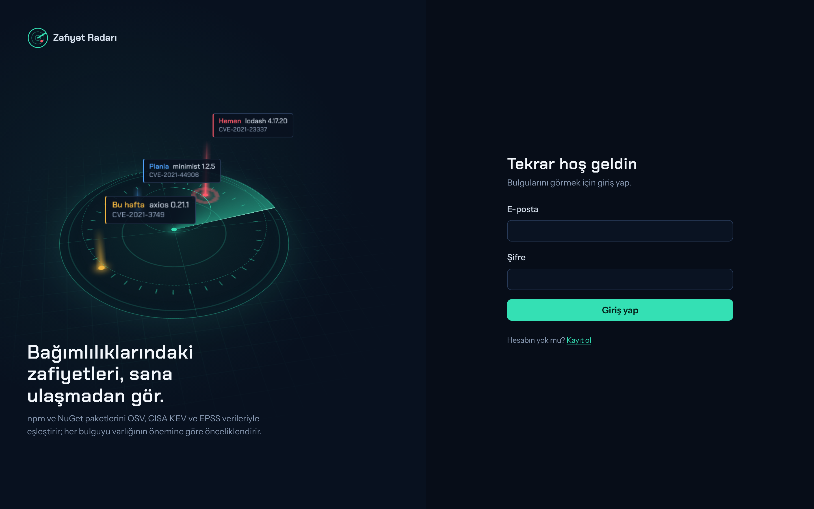
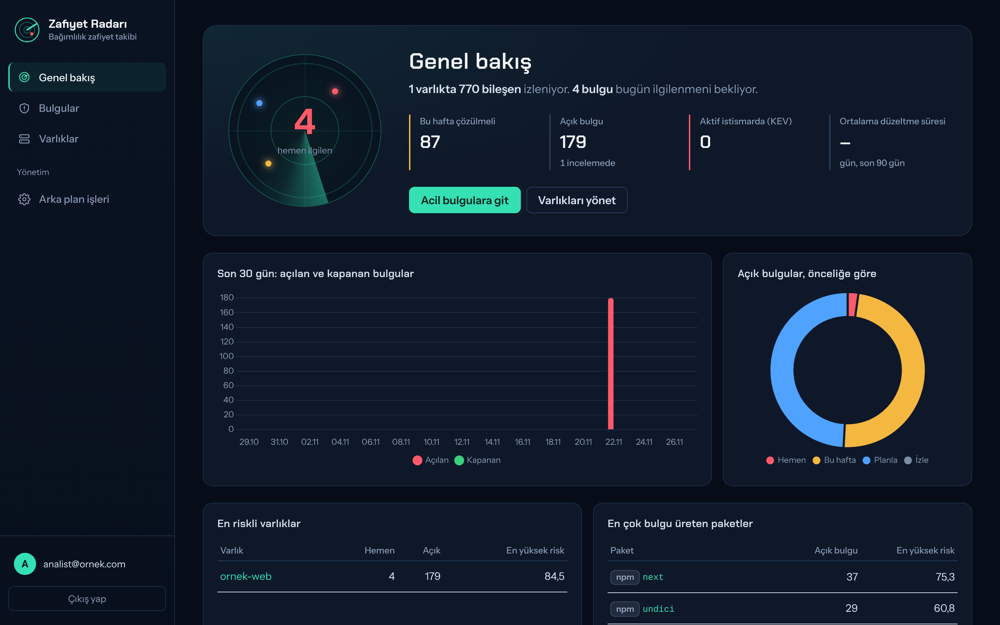
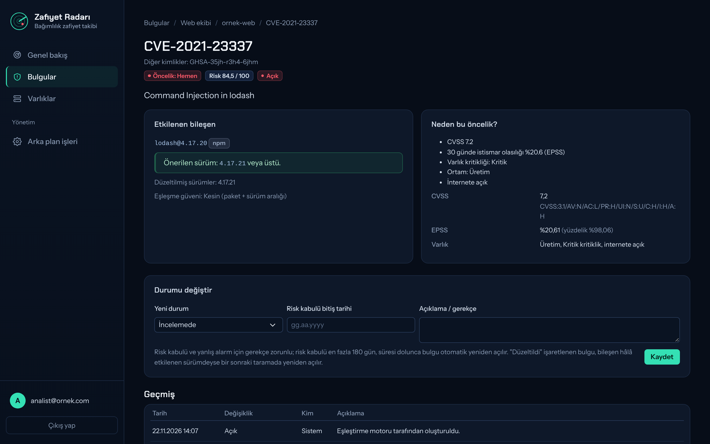
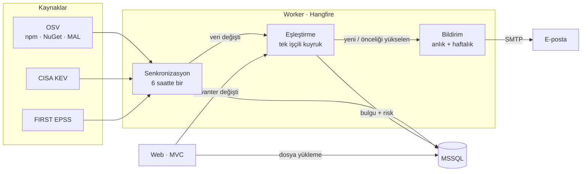

# Zafiyet Radarı

npm ve NuGet bağımlılıklarındaki zafiyetleri tek bir kaynağa (NVD) güvenmeden bulan ve **"önce hangisini düzelteyim?"** sorusunu cevaplayan zafiyet takip platformu.

**Canlı:** https://radar.muhammedasef.com



| Genel bakış | Bulgu detayı |
|---|---|
|  |  |

**Teknolojiler:** ASP.NET Core MVC (.NET 10), MSSQL (DB First), EF Core, Hangfire, DbUp, Serilog, xUnit, Docker, GitHub Actions.

## Ne yapar?

- **Envanter:** Varlıkları (uygulama, servis) gruplar altında toplar. `package-lock.json`, `packages.lock.json` veya CycloneDX SBOM yüklenir; bileşenler otomatik çıkarılır.
- **Çok kaynaklı eşleştirme:** OSV (npm, NuGet, kötü amaçlı paket kayıtları), CISA KEV (aktif istismar) ve EPSS (istismar olasılığı) verileri düzenli çekilir. Sürüm aralıkları SemVer kurallarıyla değerlendirilir; aralığı okunamayan kayıt "güvenli" sayılmaz, düşük güvenle işaretlenir.
- **Önceliklendirme:** CVSS, EPSS, KEV ve varlığın kritikliği, ortamı, internete açıklığı birlikte puanlanır. Sonuç dört kova: *Hemen*, *Bu hafta*, *Planla*, *İzle*.
- **Bulgu yaşam döngüsü:** Açık → İncelemede → Düzeltildi / Risk kabul (süreli, gerekçeli) / Yanlış alarm. Bileşen güncellenince bulgu kendiliğinden kapanır; eski sürüme dönülürse yeniden açılır. Her geçiş geçmişe yazılır.
- **Bildirimler:** Yeni bulgular kanal başına tek mailde toplanır. Açık bir bulgu sonradan CISA KEV listesine girerse veya önceliği yükselirse ayrıca haber verilir. Her pazartesi grup bazında haftalık özet gelir.
- **Ekip:** Grup üyeliği ve rolleri (sahip, düzenleyici, görüntüleyici). Kimse üyesi olmadığı grubun verisini göremez; Admin dahil.

## Nasıl çalışır?



## Mimari

```
Web, Worker ──► Application ──► Domain
     └──► Infrastructure ─┘   (Web/Worker bunu sadece DI kaydı için referans alır)
```

| Proje | Sorumluluk |
|---|---|
| `Domain` | Entity'ler (scaffold) + partial davranışlar, iş kuralları, `Result`/`Error`. Hiçbir şeye bağımlı değil. |
| `Application` | Modül bazlı arayüzler, servisler, DTO'lar, validator'lar. Veritabanını bilmez. |
| `Infrastructure` | DbContext, repository'ler, veri kaynağı client'ları, parser'lar, bildirim kanalları, Hangfire. |
| `Web` | MVC arayüzü. Her modül ayrı Area. |
| `Worker` | Hangfire job sunucusu (veri senkronizasyonu, eşleştirme, bildirim). |
| `Migrator` | Şema script'leri (DbUp), Hangfire tabloları, uygulama login'leri. Tek yetkili bileşen. |

Katman kuralları `tests/ZafiyetRadari.UnitTests/Architecture` altındaki testlerle korunur.

## Lokal çalıştırma

1. `docker compose up -d` ile SQL Server'ı başlat.
2. `powershell -ExecutionPolicy Bypass -File scripts/dev-setup.ps1` — sırları User Secrets'a yazar.
3. Sırayla çalıştır: `Migrator` → `Worker` → `Web` (`--launch-profile https`).
4. `https://localhost:5443/health` adresi `Healthy` dönmeli.
5. Uygulamadan kayıt ol (varsayılan rol: Analyst). Admin yapmak için:
   `dotnet run --project src/ZafiyetRadari.Migrator -- --grant-admin kisi@ornek.com`

## Güvenlik temeli

- **Sırlar:** Commit'lenen hiçbir dosyada şifre yok. Geliştirmede User Secrets, production'da ortam değişkenleri.
- **Least privilege:** Web `zr_web`, Worker `zr_worker` login'iyle bağlanır; DDL yetkileri yoktur. Yetkiler `db/migrations/0001_security_roles.sql` içinde.
- **SQL injection:** EF Core LINQ veya `FromSql($"...")`. Ham ADO.NET'te sadece `SqlCommandExtensions.WithParameter` (tip + boyut zorunlu). `FromSqlRaw`, `ExecuteSqlRaw`, `AddWithValue`, `Html.Raw`, `MD5`, `SHA1`, `Random` derleme hatası verir (`BannedSymbols.txt`).
- **Tedarik zinciri:** NuGet Audit; zafiyetli doğrudan/dolaylı paket build'i kırar.
- **Kimlik:** ASP.NET Core Identity (PBKDF2), 12+ karakter ve büyük harf, küçük harf, rakam, özel karakter gruplarından en az 3'ü olan, e-posta adını içermeyen şifre (kayıt formunda canlı kontrol listesi; kurallar sunucuda `PasswordPolicy` ile uygulanır), 5 denemede 15 dk kilit, `__Host-` cookie, varsayılan kapalı yetkilendirme (FallbackPolicy). Admin sadece CLI ile verilir.
- **IDOR:** Varlık grubu verisine erişim `AssetGroupAccessHandler` ile grup üyeliğine bağlı; Admin bile üye olmadığı grubu göremez.
- **Audit:** Giriş, başarısız giriş, kilitlenme, kayıt, çıkış ve 403'ler hash zincirli `ops.AuditLog`'a yazılır.
- **Web:** CSP (inline yok), HSTS, nosniff, frame-ancestors none, Referrer/Permissions-Policy, `Server` başlığı kapalı, global CSRF koruması, IP bazlı rate limiting.
- **Loglama:** Production'da yapılandırılmış JSON log; 401/403/429 Warning seviyesinde.

Ayrıntılı tasarım: proje dokümanı `zafiyet-radari-guvenlik.md`.

## Veritabanı değişikliği akışı (DB First)

1. `db/migrations` altına bir sonraki numarayla yeni script ekle (`0002_...sql`). **Uygulanmış script'ler asla değiştirilmez.**
2. `Migrator`'ı çalıştır.
3. `powershell -ExecutionPolicy Bypass -File scripts/scaffold.ps1` ile entity'leri yeniden üret.
4. Üretilen dosyalara elle dokunma: davranışlar `*.Behavior.cs`, ek EF konfigürasyonu `ZafiyetRadariDbContext.Partial.cs` partial dosyalarına yazılır.

## Canlı ortam ve CI/CD

- **Yayın:** https://radar.muhammedasef.com — Docker Compose (SQL Server Express, Web, Worker), sunucudaki nginx arkasında.
- **CI (her push/PR):** build, test, gitleaks (tüm git geçmişi), CodeQL (C# + workflow dosyaları).
- **CD (main):** chiseled imajlar → Trivy (yamalı HIGH/CRITICAL varsa durur) → CycloneDX SBOM → GHCR → SSH forced command ile `zr-deploy` (migrate, sağlık kontrolü, başarısızsa otomatik geri dönüş).
- Kurulum ve güvenlik kararları: [`deploy/KURULUM.md`](deploy/KURULUM.md).

## Güvenlik açığı bildirimi

Bir açık bulursan lütfen issue açma; [özel güvenlik bildirimi](https://github.com/MuhammedAsef/zafiyet-radari/security/advisories/new) gönder. Ayrıntılar: [`SECURITY.md`](SECURITY.md) ve [`/.well-known/security.txt`](https://radar.muhammedasef.com/.well-known/security.txt).
